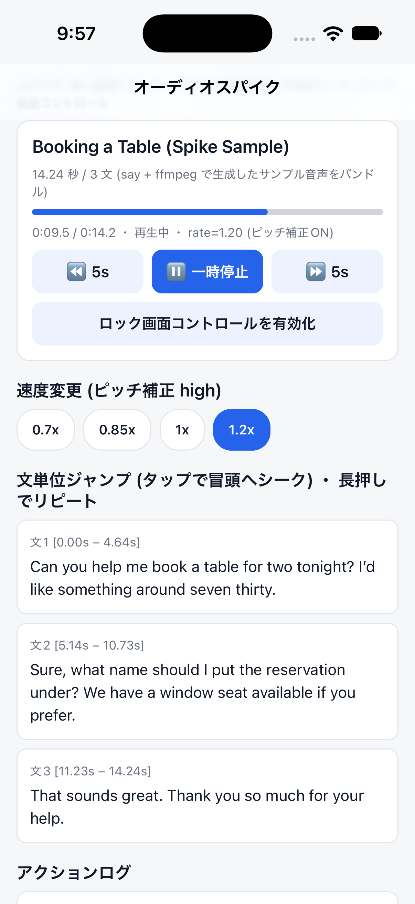
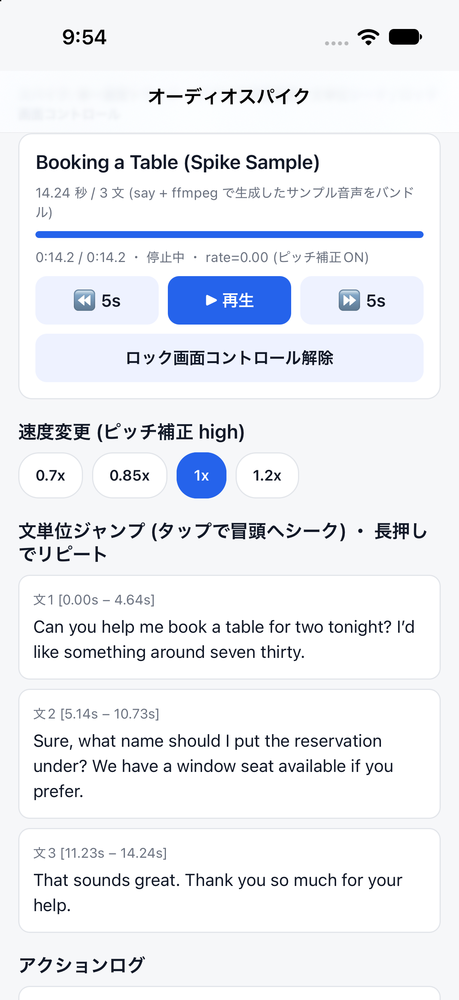

# オーディオスパイク結果 (2026-11-20)

GM 指示 #3 のオーディオ基盤スパイクの実証記録。検証環境: iPhone 17 Pro (iOS 27.0 シミュレータ) / Xcode 27.2 / Expo SDK 58 / expo-audio。

## 実証したこと

| 要件 | API | 結果 |
| --- | --- | --- |
| 再生 / 一時停止 | `player.play()` / `player.pause()` | ✅ 動作。再生位置・進捗バーが更新される |
| シーク (文単位ジャンプの土台) | `player.seekTo(sec, toleranceMillisBefore, toleranceMillisAfter)` | ✅ 動作。文の開始タイムスタンプへ正確にジャンプ (許容誤差 1ms) |
| 速度変更 0.7 / 0.85 / 1.0 / 1.2 (ピッチ補正) | `player.setPlaybackRate(rate, 'high')` | ✅ 動作。再生中に切替可能。`AudioStatus.playbackRate` / `shouldCorrectPitch` に反映 |
| ロック画面コントロール | `setActiveForLockScreen(true, metadata, options)` + `setAudioModeAsync({ interruptionMode: 'doNotMix', shouldPlayInBackground: true })` | ✅ アクティブ化成功 (メタデータ: タイトル / アーティスト、±5秒シークボタン)。ロック画面の見た目はシミュレータの UI 自動操作ができないため実機/手動での確認手順を docs/dev-setup.md に記載 |
| バックグラウンド再生の土台 | iOS `UIBackgroundModes: ['audio']` (app.config.ts) | ✅ 設定済み |

## 実証の記録 (シミュレータ実行ログ)

`?demo=1` 付きでスパイク画面を開くと、手動操作と同一の API 呼び出しを順次実行する。Metro コンソールの記録:

```text
LOG  [spike] 9:53:52 --- 自動デモ開始 (?demo=1) ---
LOG  [spike] 9:53:52 setAudioModeAsync: doNotMix / shouldPlayInBackground=true
LOG  [spike] 9:53:52 play()
LOG  [spike] 9:53:59 setPlaybackRate(0.7, high) // ピッチ補正あり
LOG  [spike] 9:53:59 setPlaybackRate(1.2, high) // ピッチ補正あり
LOG  [spike] 9:53:59 seekTo(11.23) // 文3の冒頭へ (文単位ジャンプ)
LOG  [spike] 9:53:59 setPlaybackRate(1.0, high)
LOG  [spike] 9:54:02 setActiveForLockScreen(true, metadata, seek±5s)
LOG  [spike] 9:54:02 pause() // デモ終了
```

すべての呼び出しがエラーなしで完走。スクリーンショット (docs/evidence/):




- `spike-playing-rate1.2.png`: 再生中 (0:09.5 / 0:14.2) に速度 1.2x へ変更。ステータス表示 `rate=1.20 (ピッチ補正ON)` と 1.2x チップの選択状態を確認できる
- `spike-finished-lockscreen-active.png`: 3 文目の冒頭 (11.23s) へのシーク後に再生を完走 (0:14.2/0:14.2)。ボタンが「ロック画面コントロール解除」表示 = `setActiveForLockScreen` が成功している状態

## サンプル音声

`assets/audio/spike-sample.m4a` — macOS `say` + `ffmpeg` で生成した 14.24 秒・3 文の音読 (会話: レストラン予約)。文ごとの開始秒 (0.00 / 5.14 / 11.23) は `src/features/spike/sample.ts` に定義。本実装ではコンテンツパイプライン (#1–#3) の Whisper 強制アライメント出力に置き換える。

## わかったこと / 次フェーズへの反映

1. **expo-audio で要件を充足できる** — ネイティブコード追加なしで再生・シーク・速度変更 (ピッチ補正)・ロック画面コントロールまで動く。`react-native-track-player` は不要
2. **ロック画面コントロールには `interruptionMode: 'doNotMix'` が必要** (expo-audio の仕様)。`mixWithOthers` のままでは OS がプレイヤーと紐付けない
3. **文単位リピート (ABリピートの土台)** は `seekTo` + 再生位置監視で実装できることをスパイク画面に実装済み (文カード長押し)。#9 の AB リピートへそのまま展開できる
4. 速度は `AudioStatus.playbackRate` から読み取れるため、カラオケ同期 (#6) の時間計算は実速度で補正可能
5. Android は未検証 (エミュレータなし)。Android 実機/エミュレータでの確認は次フェーズの最初に実施する
